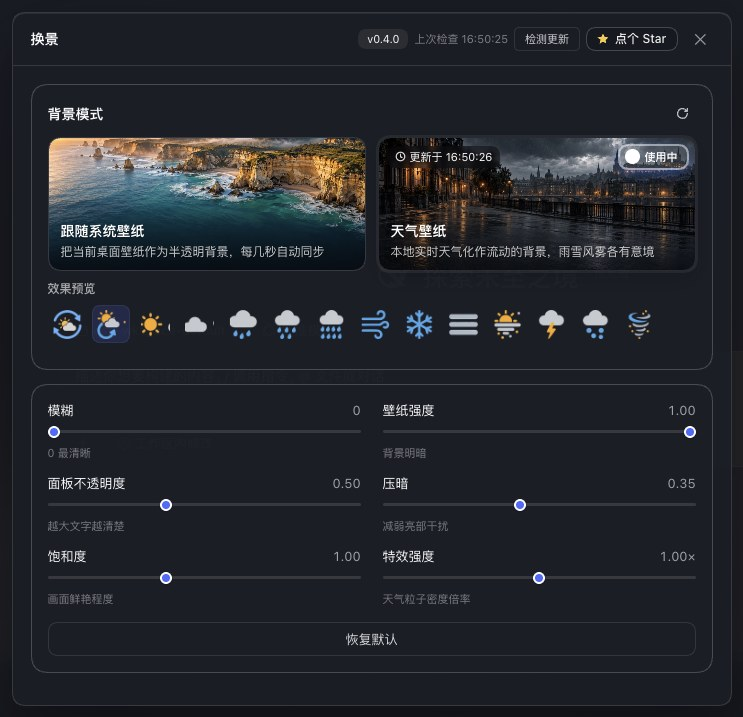
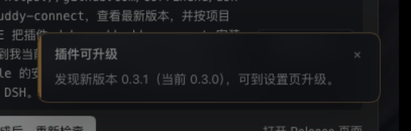
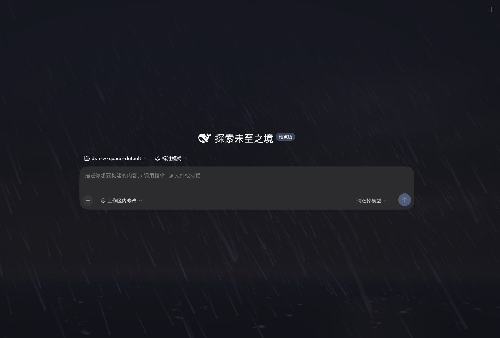

# dsh-wallpaper

把**当前桌面的壁纸**变成 DeepSeek Harness 界面的半透明实时背景。

壁纸每几秒同步一次，跟随系统换图；也可切换为天气壁纸模式。参数在账号菜单的「换景」里实时调节。

---

## 它能做什么

- **实时同步**：读取当前桌面壁纸，每 6 秒检查一次，只有画面真的变化时才更新，不闪屏
- **跟随系统换壁纸**：macOS 的航拍/动态壁纸、Windows 的幻灯片轮换都会自动跟上
- **天气壁纸模式**：按 IP 定位获取当地实时天气，用 Canvas 粒子动画把晴/雨/雪/雾/雷暴等 12 种天气「演」成全屏背景，每小时自动更新
- **可调节外观**：模糊、强度、面板不透明度、压暗、饱和度五个参数，实时生效；天气模式额外提供「特效强度」
- **深色/浅色主题自适应**：两种主题使用不同的默认压暗值，切换主题立即跟随
- **弹窗不受影响**：设置、对话框等浮层保持不透明，不会因为背景变透明而看不清文字
- **新版本提醒**：后台每 6 小时检查一次 GitHub Release，有新版时右下角弹出提示，14 秒后自动消失，设置页导航项带标记
- **一键热更新**：在「换景」弹窗头部点「有新版本可用」直接安装，成功后立即生效，不用重启、不用敲命令

## 界面

主界面：桌面壁纸作为半透明背景，聊天内容保持清晰可读。


「换景」弹窗：背景模式二选一、效果预览、五个外观滑块 + 天气特效强度、一键恢复默认；头部有版本号、检测更新与升级入口。



有新版时的提示（右下角，只说去设置页升级，14 秒后自动消失）：



## 天气壁纸模式

「换景」弹窗顶部是**背景模式**卡片组：「跟随系统壁纸」（默认）与「天气壁纸」二选一，点击立即生效，选择记忆在浏览器本地。

- **数据链路全在 Host 半区**：IP 定位（ipwho.is 为主、ip-api.com 备）→ Open-Meteo 天气预报 + 空气质量 → 归一化成 12 种天气枚举（晴/多云/小雨/中雨/暴雨/狂风/下雪/雾/雾霾/雷暴/冰雹/沙尘）随现有 discover 轮询下发；浏览器半区零新增网络请求
- **每小时更新一次**：首次激活约 15 秒后获取，随后每 1 小时一次；设置页可「立即刷新」，手动刷新不打乱自动节奏
- **零依赖渲染**：天气背景渲染在单个 `<canvas>` 上，**WebGL2 优先、Canvas 2D 自动降级**（无 WebGL2 或着色器编译失败时切到 2D，也可用 `?renderer=canvas` 强制），不引入任何第三方库；雨丝斜角、雪片摇摆、雾团呼吸、雷暴闪电、冰雹反弹、沙尘阵风各有配置；昼夜色调跟随天气数据里的 `is_day`
- **省电**：天气模式下 Host 暂停桌面抓帧；页面不可见时暂停渲染循环；`prefers-reduced-motion` 下降级为静态渐变
- **外观参数全生效**：模糊、饱和度（CSS filter 作用于画布）、壁纸强度（画布不透明度）、压暗、面板不透明度与系统模式完全一致；「特效强度」滑块（0.5–1.5）乘在粒子密度上
- **效果预览**：天气模式下弹窗内提供 14 个效果图标——「跟随真实天气」「动态演化」加 12 种天气，点任意一个立即预览，悬停有说明

雷暴效果（全屏雨丝 + 闪电，聊天文字保持清晰）：



### 降级行为

任何一步失败都不黑屏、不弹窗，只会安静退化：

| 失败路径 | 表现 |
|---|---|
| IP 定位失败 | 自动切备用定位服务；仍失败则用配置的固定坐标，再不行用默认坐标（北京） |
| 天气请求失败 | 沿用上次成功数据（6 小时内）；超过则显示默认「多云」效果，设置页有一行灰色提示 |
| 空气质量请求失败 | 跳过雾霾/沙尘判定，雾类天气显示为「雾」 |
| 卡片配图缺失 | 显示 CSS 渐变兜底，无破图 |
| 隐私模式（localStorage 抛异常） | 回落配置默认值，无报错 |

### 天气相关配置

| 参数 | 默认值 | 范围 | 说明 |
|---|---|---|---|
| `mode` | `system` | `system` / `weather` | 默认背景模式（用户的选择优先） |
| `weatherIntervalMs` | `3600000` | 600000–86400000 | 天气刷新间隔，单位毫秒 |
| `weatherLat` / `weatherLon` | 不启用 | 任意有限数 | 可选：IP 定位失败时使用的固定坐标 |

```yaml
- insert:
    - id: dsh-wallpaper
      name: 'dsh-wallpaper'
      config:
        mode: 'weather'
        weatherIntervalMs: 3600000
        # weatherLat: 39.9042
        # weatherLon: 116.4074
```

## 平台支持

| 平台 | 读取方式 | 状态 |
|---|---|---|
| **macOS** | 截取系统的壁纸窗口（`screencapture`），因此动态航拍壁纸也能拿到当前帧。窗口归属按版本兼容：macOS ≤ 26 由 Dock 绘制，macOS 27+ 由 WindowManager 绘制 | 已验证（macOS 27.0.1） |
| **Windows** | 读取注册表 `HKCU\Control Panel\Desktop\Wallpaper`，幻灯片轮换时跟随当前图片；读取失败时用 .NET 采样桌面 | 已实现，待实机验证 |
| **Linux** | 依次尝试 GNOME `gsettings`、XFCE `xfconf`；需要 ImageMagick 转码 | 已实现，待实机验证 |

未列出的平台不会导致插件失效，只是不会显示背景（状态接口会报告 `unsupported platform`）。

### 各平台依赖

- **macOS**：需要 Xcode Command Line Tools（提供 `swiftc`），用于编译一次性窗口枚举器
- **Windows**：依赖系统自带的 PowerShell 与 .NET（Windows 10/11 默认具备）
- **Linux**：需要 `imagemagick`（`magick` 或 `convert`）

## 安装

### 从 GitHub 安装

```bash
dsh plugin --profile <你的 profile> add github:liuleiyu121520/dsh-wallpaper
```

建议固定到某个提交，避免上游变更影响本地（把 `<commit>` 换成本仓库 `main` 上的任意提交 ID）：

```bash
dsh plugin --profile <你的 profile> add github:liuleiyu121520/dsh-wallpaper#<commit>
```

### 从 DSH Hub 安装

在 DSH Hub 的插件页点击安装，或在 Harness 的「设置 → 插件」中搜索 `dsh-wallpaper`。

### 从本地目录安装（开发用）

```bash
dsh plugin --profile <你的 profile> add /absolute/path/to/dsh-wallpaper
```

安装后重启 Harness，在账号菜单点「换景」调整参数。

## 配置

所有参数都可以在设置页实时调节，也可以写在 `cordis.patch.yml` 的 `config` 中作为默认值：

| 参数 | 默认值 | 范围 | 说明 |
|---|---|---|---|
| `intervalMs` | `6000` | 500–600000 | 壁纸检查间隔，单位毫秒 |
| `opacity` | `1` | 0.02–1 | 壁纸整体强度 |
| `blurPx` | `0` | 0–80 | 模糊半径，0 为原图 |
| `scrim` | `0.35` | 0–1 | 压暗层强度，越大文字越清楚 |
| `saturate` | `1` | 0.2–3 | 饱和度 |
| `surface` | `0.5` | 0.2–1 | 面板不透明度 |
| `mode` | `system` | `system` / `weather` | 默认背景模式，天气模式见上文 |
| `weatherIntervalMs` | `3600000` | 600000–86400000 | 天气刷新间隔 |

浅色主题下 `scrim` 默认使用 `0.1`，因为白色遮罩比深色更容易让画面变淡。

示例：

```yaml
- insert:
    - id: dsh-wallpaper
      name: 'dsh-wallpaper'
      config:
        intervalMs: 6000
        blurPx: 12
        scrim: 0.3
        surface: 0.55
```

## 权限与副作用

- **读取屏幕内容**：macOS 首次使用需要授予「屏幕录制」权限，否则截取结果是空白
- **读取注册表**：Windows 上只读取当前用户的桌面壁纸路径，不修改任何系统设置
- **网络**：仅在你点击「检查更新」时访问 GitHub Releases 接口；选择「天气壁纸」模式后，由 Host 半区每小时访问一次 IP 定位与 Open-Meteo 天气接口（浏览器半区不直连任何第三方域）
- **不修改桌面**：插件只读取壁纸，不会改变你的桌面设置

## 卸载

```bash
dsh plugin --profile <你的 profile> remove dsh-wallpaper
```

或在「设置 → 插件」中停用/移除。卸载后界面的半透明背景会立即消失，桌面壁纸本身不受影响。

## 工作原理

```
┌──────────────┐   每 6 秒   ┌──────────────┐   变化才更新   ┌──────────────┐
│ 平台后端      │ ──────────> │ Host 半区     │ ───────────> │ 浏览器半区    │
│ 读取桌面壁纸  │             │ 压缩 + 版本号 │   /api/...   │ 双图层淡入    │
└──────────────┘             └──────────────┘              └──────────────┘
```

1. **平台后端**（`src/backends/`）把当前壁纸读成 PNG
2. Host 半区压成 1600px JPEG，并用 32×32 灰度探针判断画面是否真的变化；没变就不递增版本号
3. 浏览器半区轮询版本号，只在新版本时拉取图片，解码完成后交叉淡入
4. 通过重写 `--dsw-alias-bg-base` 等主题变量让面板半透明，同时保证浮层不透明

## 开发

```bash
# 修改 src/ 后重新生成 lib/
node scripts/build.mjs

# 安装到本地 profile 试用
dsh plugin --profile <你的 profile> add /absolute/path/to/dsh-wallpaper
```

- `src/index.js` — Host 半区：HTTP 路由、抓帧循环、天气服务装配、版本检查
- `src/weather.js` — Host 半区：定位、Open-Meteo 双请求、kind 归一化、缓存与降级
- `src/client.js` — 浏览器半区：背景图层与模式状态机、WebGL2/Canvas2D 天气引擎、换景弹窗、更新提醒
- `src/capture.js` — 平台后端选择器
- `src/backends/*.js` — 各平台壁纸实现
- `lib/` — 发布产物（由 `scripts/build.mjs` 从 `src/` 生成，请勿直接修改）

### 发版流程

版本检查读的是 **GitHub Release 的 tag**，只推 tag 不发 Release 不会触发提醒。发版三步：

```bash
# 1. 改 package.json 的 version，重新构建
node scripts/build.mjs

# 2. 提交推送
git commit -am "chore: release vX.Y.Z" && git push

# 3. 在 GitHub 上基于该提交创建 Release，tag 用 vX.Y.Z
```

`tag_name` 去掉前导 `v` 后必须大于 `package.json` 的 `version`，否则判定为「已是最新」。

## 已知限制

- **设置页图标**：左侧导航的图标由 Harness 按 section id 白名单渲染，第三方插件只能显示通用图标，这属于宿主行为
- **动态壁纸帧率**：macOS 的动态航拍壁纸在桌面上本身是静止帧（视频只在锁屏播放），因此背景也是静态同步
- **多显示器**：目前只同步主显示器（窗口 id 最小的那个）

## 许可

[MIT](LICENSE)
