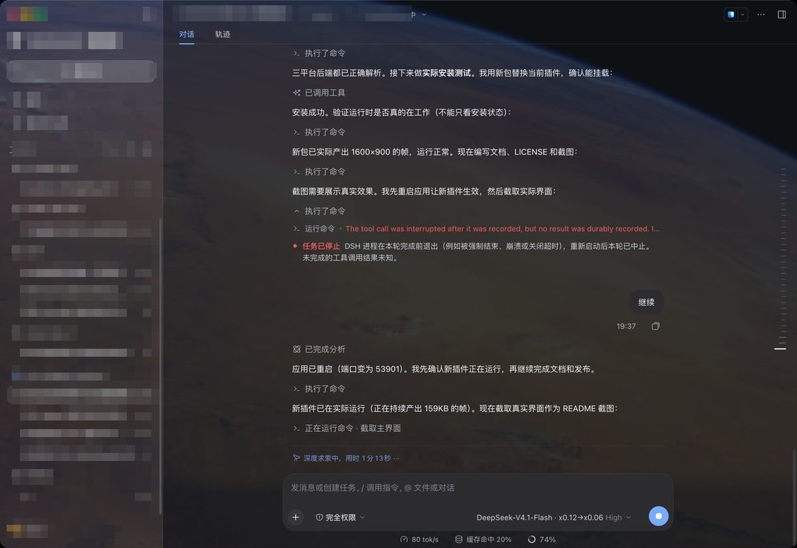

# dsh-wallpaper

把**当前桌面的壁纸**变成 DeepSeek Harness 界面的半透明实时背景。

壁纸每几秒同步一次，跟随系统换图；参数在「设置 → 实时壁纸外观」里实时调节。



---

## 它能做什么

- **实时同步**：读取当前桌面壁纸，每 6 秒检查一次，只有画面真的变化时才更新，不闪屏
- **跟随系统换壁纸**：macOS 的航拍/动态壁纸、Windows 的幻灯片轮换都会自动跟上
- **可调节外观**：模糊、强度、面板不透明度、压暗、饱和度五个参数，实时生效
- **深色/浅色主题自适应**：两种主题使用不同的默认压暗值，切换主题立即跟随
- **弹窗不受影响**：设置、对话框等浮层保持不透明，不会因为背景变透明而看不清文字

## 平台支持

| 平台 | 读取方式 | 状态 |
|---|---|---|
| **macOS** | 截取 Dock 的壁纸窗口（`screencapture`），因此动态航拍壁纸也能拿到当前帧 | 已验证 |
| **Windows** | 读取注册表 `HKCU\Control Panel\Desktop\Wallpaper`，幻灯片轮换时跟随当前图片；读取失败时用 .NET 采样桌面 | 已实现，待实机验证 |
| **Linux** | 依次尝试 GNOME `gsettings`、XFCE `xfconf`；需要 ImageMagick 转码 | 已实现，待实机验证 |

未列出的平台不会导致插件失效，只是不会显示背景（状态接口会报告 `unsupported platform`）。

### 各平台依赖

- **macOS**：需要 Xcode Command Line Tools（提供 `swiftc`），用于编译一次性窗口枚举器
- **Windows**：依赖系统自带的 PowerShell 与 .NET（Windows 10/11 默认具备）
- **Linux**：需要 `imagemagick`（`magick` 或 `convert`）

## 安装

### 从 GitHub 安装

```bash
dsh plugin --profile <你的 profile> add github:<owner>/dsh-wallpaper
```

建议固定到某个提交，避免上游变更影响本地：

```bash
dsh plugin --profile <你的 profile> add github:<owner>/dsh-wallpaper#<commit-sha>
```

### 从 DSH Hub 安装

在 DSH Hub 的插件页点击安装，或在 Harness 的「设置 → 插件」中搜索 `dsh-wallpaper`。

### 从本地目录安装（开发用）

```bash
dsh plugin --profile <你的 profile> add /absolute/path/to/dsh-wallpaper
```

安装后重启 Harness，在「设置 → 实时壁纸外观」里调整参数。

## 配置

所有参数都可以在设置页实时调节，也可以写在 `cordis.patch.yml` 的 `config` 中作为默认值：

| 参数 | 默认值 | 范围 | 说明 |
|---|---|---|---|
| `intervalMs` | `6000` | 500–600000 | 壁纸检查间隔，单位毫秒 |
| `opacity` | `1` | 0.02–1 | 壁纸整体强度 |
| `blurPx` | `0` | 0–80 | 模糊半径，0 为原图 |
| `scrim` | `0.35` | 0–1 | 压暗层强度，越大文字越清楚 |
| `saturate` | `1` | 0.2–3 | 饱和度 |
| `surface` | `0.5` | 0.2–1 | 面板不透明度 |

浅色主题下 `scrim` 默认使用 `0.1`，因为白色遮罩比深色更容易让画面变淡。

示例：

```yaml
- insert:
    - id: dsh-wallpaper
      name: 'dsh-wallpaper'
      config:
        intervalMs: 6000
        blurPx: 12
        scrim: 0.3
        surface: 0.55
```

## 权限与副作用

- **读取屏幕内容**：macOS 首次使用需要授予「屏幕录制」权限，否则截取结果是空白
- **读取注册表**：Windows 上只读取当前用户的桌面壁纸路径，不修改任何系统设置
- **网络**：仅在你点击「检查更新」时访问 GitHub Releases 接口
- **不修改桌面**：插件只读取壁纸，不会改变你的桌面设置

## 卸载

```bash
dsh plugin --profile <你的 profile> remove dsh-wallpaper
```

或在「设置 → 插件」中停用/移除。卸载后界面的半透明背景会立即消失，桌面壁纸本身不受影响。

## 工作原理

```
┌──────────────┐   每 6 秒   ┌──────────────┐   变化才更新   ┌──────────────┐
│ 平台后端      │ ──────────> │ Host 半区     │ ───────────> │ 浏览器半区    │
│ 读取桌面壁纸  │             │ 压缩 + 版本号 │   /api/...   │ 双图层淡入    │
└──────────────┘             └──────────────┘              └──────────────┘
```

1. **平台后端**（`src/backends/`）把当前壁纸读成 PNG
2. Host 半区压成 1600px JPEG，并用 32×32 灰度探针判断画面是否真的变化；没变就不递增版本号
3. 浏览器半区轮询版本号，只在新版本时拉取图片，解码完成后交叉淡入
4. 通过重写 `--dsw-alias-bg-base` 等主题变量让面板半透明，同时保证浮层不透明

## 开发

```bash
# 修改 src/ 后重新生成 lib/
node scripts/build.mjs

# 安装到本地 profile 试用
dsh plugin --profile <你的 profile> add /absolute/path/to/dsh-wallpaper
```

- `src/index.js` — Host 半区：HTTP 路由、抓帧循环、版本检查
- `src/client.js` — 浏览器半区：背景图层、设置页
- `src/capture.js` — 平台后端选择器
- `src/backends/*.js` — 各平台壁纸读取实现
- `lib/` — 发布产物（由 `scripts/build.mjs` 从 `src/` 生成，请勿直接修改）

## 已知限制

- **设置页图标**：左侧导航的图标由 Harness 按 section id 白名单渲染，第三方插件只能显示通用图标，这属于宿主行为
- **动态壁纸帧率**：macOS 的动态航拍壁纸在桌面上本身是静止帧（视频只在锁屏播放），因此背景也是静态同步
- **多显示器**：目前只同步主显示器（窗口 id 最小的那个）

## 许可

[MIT](LICENSE)
