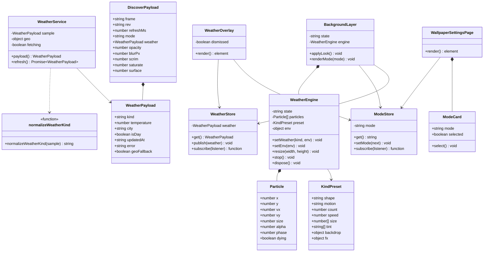
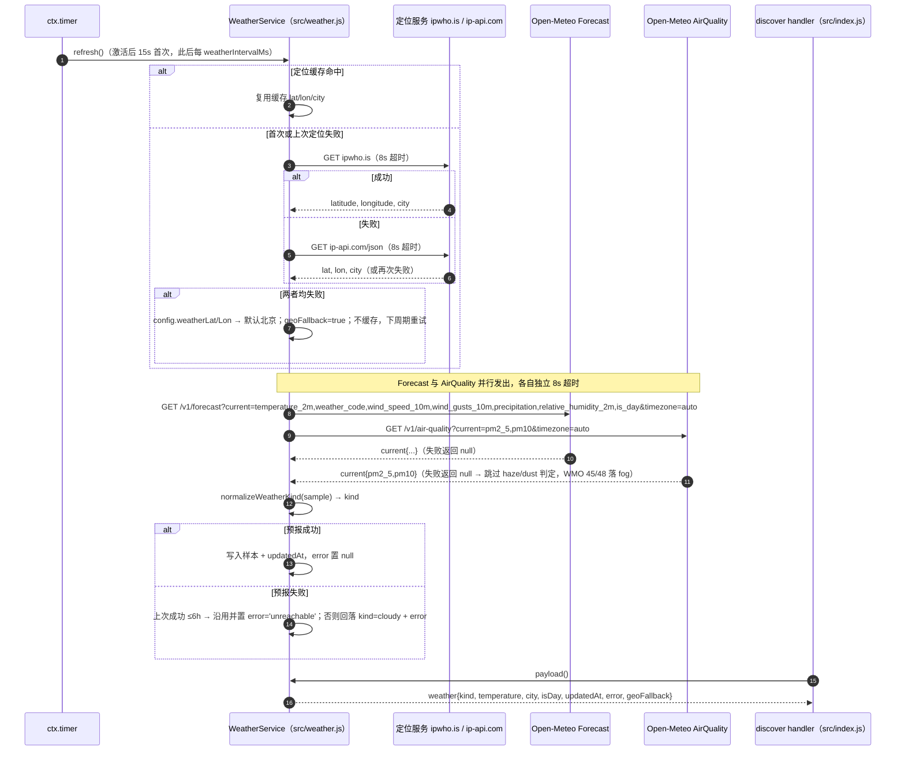
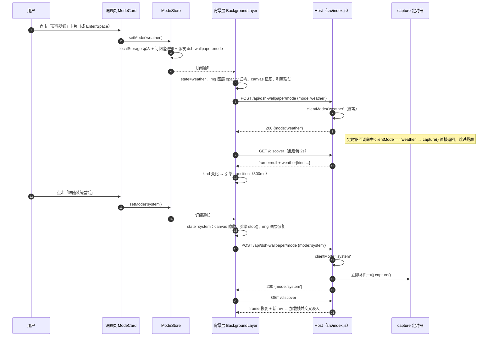
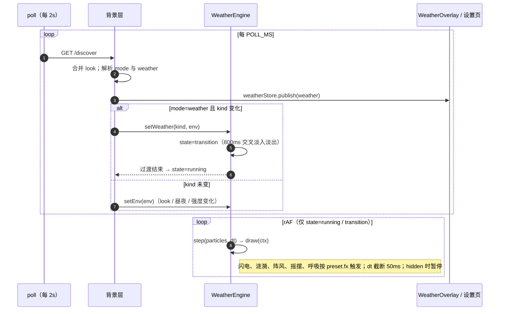
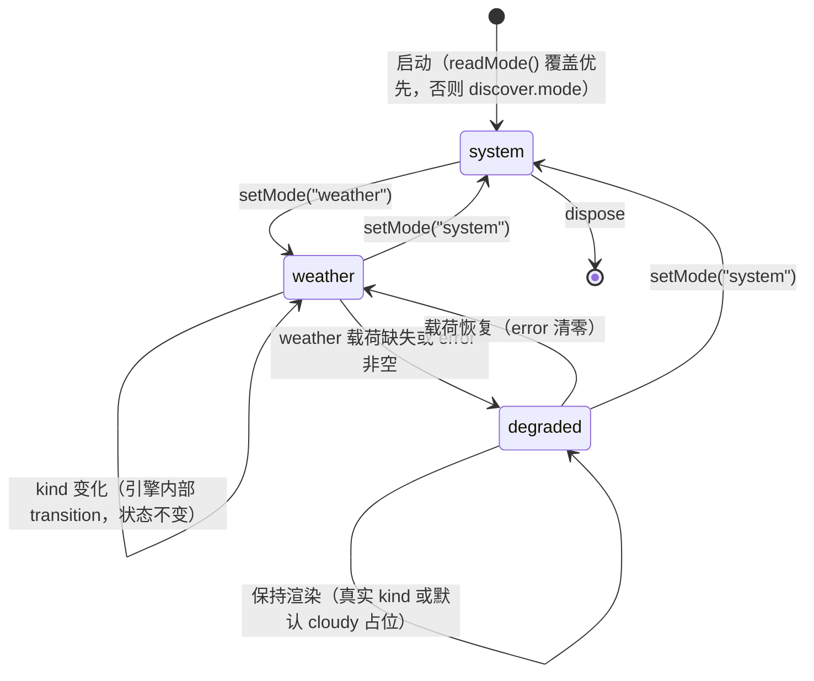
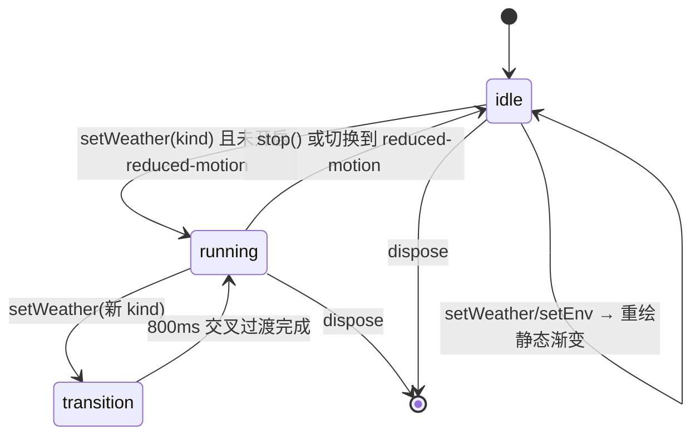
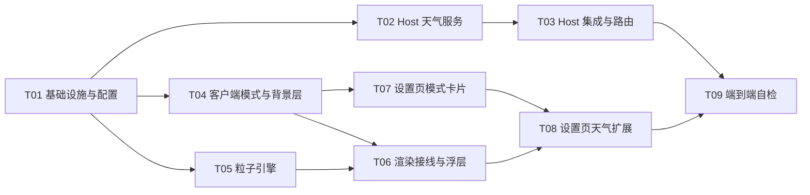

# 增量架构设计：天气壁纸模式（Weather Wallpaper Mode）

> **文档信息**
> - 关联需求：`docs/weather-mode-prd.md`（PM 已评审通过，本文档是需求基准的唯一下游）
> - 决策输入：主理人对 PRD §7 七项待确认问题的定夺（逐条确认见 §1.2）
> - 设计范围：Host 半区（`src/index.js` + 新增 `src/weather.js`）、浏览器半区（`src/client.js` 单文件增量）、配置与 i18n
> - 硬约束：零第三方依赖、纯 ESM、`scripts/build.mjs` 保持「拷贝 + 语法检查」不变、浏览器半区保持单文件 `client.js`
> - 本文档是工程师施工契约：接口形状、kind 枚举、归一化顺序、降级矩阵、存储键均以此为准，变更须先改本文档

---

## Part A — 系统设计

### 1. 实现方案

#### 1.1 核心技术难点

1. **天气数据链路必须全部落在 Host 半区**。ipwho.is / ip-api.com / Open-Meteo 由浏览器直连会撞 CORS 或混合内容（ip-api.com 免费端点仅 HTTP）；Node 侧 `fetch` 无此限制，且天然适合收敛「1h 缓存 + 8s 超时 + 静默降级」。
2. **kind 归一化是跨半区契约**。WMO 码、风速/降水阈值、PM2.5/PM10 阈值、AQ 失败降级必须在 Host 一处收敛成 12 值枚举，客户端只认枚举——否则两端规则漂移，出现「Host 说暴雨、客户端画晴」。
3. **`client.js` 单文件从 917 行增长到约 1800 行**。`window.__ModuleLoader__.load` 的 factory 只拿到宿主 `require`（react 等），无法可靠 require 兄弟文件，因此用「分区注释 + 工厂函数」在文件内做模块边界，不拆文件。
4. **Canvas 2D 引擎要同时满足 12 种 kind、1.5s 过渡、1080p ≥ 30fps、reduced-motion 降级**。粒子数按视口面积缩放并封顶；dt 截断防切标签跳帧；页面隐藏时暂停 rAF。
5. **外观五参数在天气模式全部生效**。blur/saturate 是 CSS filter，作用在 canvas 上需要 overscan 防边缘穿透（复用现有 img bleed 思路，client.js:203-207）；opacity 作用在 canvas；scrim 与面板 token 两模式共用不变。
6. **天气模式暂停抓帧引入「Host 状态依赖客户端上报」的耦合**。用幂等 POST + 客户端 start 时重报 + 插件重载后自动重同步来收敛；多标签页 last-writer-wins 记为已知限制（§5）。

#### 1.2 选型结论（对应主理人 7 条定夺，逐条确认）

| # | 主理人定夺 | 架构落点 |
|---|---|---|
| 1 | 渲染引擎 = Canvas 2D，不引入 Three.js | `src/client.js` 新增引擎区：`KIND_PRESETS` + `createWeatherEngine(canvas)`，rAF 驱动，零依赖；build.mjs 零改动 |
| 2 | 天气 API = Open-Meteo（current 七字段 + timezone=auto） | `src/weather.js` 顶部常量 `FORECAST_ENDPOINT`；AQ 同提供商免 key |
| 3 | IP 定位 = ipwho.is 主 + ip-api.com 备，仅 Host 调用 | `src/weather.js` `resolveGeo()`：成功才缓存；失败走 config 坐标 → 默认北京，置 `geoFallback`，下周期重试 |
| 4 | 雾霾拆分进 P0：PM2.5 ≥ 150 → haze；WMO 45/48 且 PM2.5 < 150 → fog；AQ 失败 → fog | `normalizeWeatherKind()` 判定序 11–13（§3.1）；AQ 与主请求 `Promise.all` 并行、独立 8s 超时、失败记 null 不阻塞主流程 |
| 5 | 外观五参数在天气模式全部生效 | `applyLook()` 增加 canvas 分支：`filter: blur()+saturate()` + bleed overscan + opacity；scrim 层与面板 token 逻辑不动 |
| 6 | 天气模式暂停抓帧进 P0 | Host 内存 `clientMode` + `POST /api/dsh-wallpaper/mode`（幂等）；`capture()` 开头守卫；discover `frame: null`；切回 system 立即补抓一帧 |
| 7 | 卡片配图 = sharesai-imagegen 两张摄影图 | `assets/card-system.jpg`、`assets/card-weather-wallpaper.jpg`；`package.json` files 追加 `assets/`；Host 白名单只读静态路由；客户端 `` + CSS 渐变兜底（图片缺失也能看） |

#### 1.3 架构模式

- **Host：服务模块 + 薄路由层**。`src/weather.js` 拥有全部天气领域逻辑（定位、请求、归一化、缓存、降级），`src/index.js` 只做装配：定时器、discover 字段拼装、三个新路由、抓帧守卫。与现有 `src/capture.js`（平台后端选择）的分层风格一致。
- **浏览器：单文件内工厂函数分区**。`modeStore` / `weatherStore`（发布订阅，仿 `updateStore`）→ 背景层状态机（system/weather/degraded）→ 粒子引擎（自包含工厂）→ React 组件（天气浮层、模式卡片）经 store 与背景层解耦，互不直接调用。
- **两端契约**：discover 载荷扩展 + mode/assets/weather-refresh 三个路由 + localStorage 键与事件，全部在 §3 冻结。

---

### 2. 文件清单

| 文件 | 类型 | 职责 | 行数量级 |
|---|---|---|---|
| `src/weather.js` | **新增** | Host 天气服务：`WEATHER_KINDS`、`normalizeWeatherKind`、`createWeatherService`（定位链、Open-Meteo 双请求、8s 超时、6h 陈旧沿用、默认 cloudy 降级） | ~240 |
| `src/index.js` | 修改 | 接入 weather service；discover 扩展 `mode`/`weather`；新增 mode / assets / weather-refresh 路由；`capture()` 天气模式守卫 | 468 → ~650 |
| `src/client.js` | 修改 | modeStore/weatherStore、模式上报、背景层状态机与 canvas 层、粒子引擎、天气浮层、设置页模式卡片与天气扩展 | 917 → ~1800 |
| `cordis.patch.yml` | 修改 | config 默认值 `mode: 'system'`、`weatherIntervalMs: 3600000`；可选 `weatherLat`/`weatherLon`（注释形式给出） | 11 → 17 |
| `package.json` | 修改 | `files` 数组追加 `"assets/"` | +1 |
| `locale/zh.json` | 修改 | 新增 26 键（§8.3，含 3 个架构师新增键） | 26 → ~52 |
| `locale/en.json` | 修改 | 同上，键集合与 zh 完全一致 | 26 → ~52 |
| `assets/card-system.jpg` | **新增** | 「跟随系统壁纸」模式卡片摄影图（主理人生成，约 560×264） | — |
| `assets/card-weather-wallpaper.jpg` | **新增** | 「天气壁纸」模式卡片摄影图（主理人生成） | — |
| `README.md` | 修改 | 补充天气模式章节（T09） | +~30 |
| `scripts/build.mjs` | 不变 | 拷贝 + 语法检查；`src/weather.js` 有 export，自动满足检查 | 41 |

> `assets/` 位于包根（与 `locale/`、`icon.svg` 同级），Host 侧 `PACKAGE_DIR` 即包根（index.js:26），读盘路径天然成立。

---

### 3. 数据结构与接口

#### 3.1 kind 枚举与归一化规则

**kind 枚举（12 值；唯一事实来源 = `src/weather.js` 导出的 `WEATHER_KINDS`）：**

```
clear | cloudy | drizzle | rain | heavyRain | wind | snow | fog | haze | thunderstorm | hail | dust
```

`normalizeWeatherKind(sample)` 输入 `{ weatherCode, temperature, windSpeed, windGusts, precipitation, pm2p5, pm10 }`（`weatherCode` 须为整数，其余字段允许 null），**按顺序首个命中即返回，顺序即优先级，实现不得重排**：

| 序 | 条件 | kind |
|---|---|---|
| 1 | weatherCode = 95 | thunderstorm |
| 2 | weatherCode ∈ {96, 99} 且（temperature < 2 或 precipitation > 10） | hail |
| 3 | weatherCode ∈ {96, 99} | thunderstorm |
| 4 | weatherCode ∈ {71, 73, 75, 77, 85, 86} | snow |
| 5 | weatherCode ∈ {65, 82} | heavyRain |
| 6 | weatherCode ∈ {63, 80, 81, 66, 67} | rain |
| 7 | weatherCode ∈ {51, 53, 55, 56, 57, 61} | drizzle |
| 8 | precipitation > 10 | heavyRain |
| 9 | precipitation ≥ 2.5 | rain |
| 10 | precipitation > 0 | drizzle |
| 11 | pm10 ≥ 200 且 windSpeed ≥ 30 | dust |
| 12 | pm2p5 ≥ 150 | haze |
| 13 | weatherCode ∈ {45, 48} | fog |
| 14 | windSpeed ≥ 50 或 windGusts ≥ 75 | wind |
| 15 | weatherCode = 0 | clear |
| 16 | 其它（WMO 1–3、未知码、全 null） | cloudy（默认降级） |

规则说明（对应 PRD §5 与主理人定夺 4）：

- 序 12 先于序 13：PM2.5 ≥ 150 一律出 haze；WMO 45/48 且 PM2.5 < 150（**含 AQ 失败致 pm2p5 = null**）出 fog——AQ 请求失败即降级为雾，不阻塞主流程。
- 序 8–10 兜住「晴但有阵雨」与纯降水读数；序 14 狂风只在无降水命中之后生效，天然满足 PRD「无强降水时」。
- 未知 WMO 码（如 4 = 烟雾）落 cloudy，与 PRD「多云为默认降级效果」一致。
- 序 6 含 66/67（冻雨，无专属 kind）；序 7 含 56/57（冻毛毛雨）。

#### 3.2 discover 接口扩展

`GET /api/dsh-wallpaper/discover` 在现有字段后追加 `mode` 与 `weather`（其余字段不变）：

```json
{
  "frame": "/api/dsh-wallpaper/<token>/frame.jpg",
  "rev": "12-345678",
  "refreshMs": 2000,
  "platform": "darwin",
  "backend": "macos",
  "error": null,
  "opacity": 1, "blurPx": 0, "scrim": 0.35, "saturate": 1, "surface": 0.5,
  "mode": "system",
  "weather": {
    "kind": "rain",
    "temperature": 12.4,
    "city": "Beijing",
    "isDay": true,
    "updatedAt": "2026-10-14T09:30:00.000Z",
    "error": null,
    "geoFallback": false
  }
}
```

| 字段 | 类型 | 语义 |
|---|---|---|
| `mode` | string | **config 默认模式**（`cordis.patch.yml`），不是 Host 运行时模式；客户端 resolution = localStorage 覆盖 ?? 此值 ?? `'system'` |
| `weather.kind` | string | §3.1 枚举；服务初始态为 `cloudy` |
| `weather.temperature` | number \| null | ℃；失败且无陈旧可用数据时为 null |
| `weather.city` | string \| null | 定位城市；geo 降级时为 null（客户端浮层退化为两段文案） |
| `weather.isDay` | boolean | 来自 Open-Meteo `is_day`；初始态按本地 6–18 时推导 |
| `weather.updatedAt` | string \| null | ISO 8601 UTC；首次成功前为 null |
| `weather.error` | string \| null | `'pending'`（尚未首次成功）/ `'unreachable'`（本次失败，可能仍沿用陈旧数据）/ null |
| `weather.geoFallback` | boolean | 定位降级为固定/默认坐标 |
| `frame` | string \| null | **Host 运行时模式为 weather 时为 null**（抓帧已暂停，客户端不再发起 frame 请求） |

向后兼容（PRD P0-4 ③）：旧客户端忽略新字段；`frame` 仅在「新客户端上报 weather 模式」之后为 null，旧客户端永不上报故行为不变。

#### 3.3 mode 接口契约（主理人定夺 6）

`POST /api/dsh-wallpaper/mode`

| 项 | 契约 |
|---|---|
| 请求体 | `{"mode": "system" \| "weather"}`，content-type application/json，≤ 4KB |
| 200 | `{"mode": "system"}` — Host 当前生效的运行时模式 |
| 400 | 体缺失 / JSON 非法 / mode 非枚举值 |
| 405 | 非 POST |
| 幂等 | 重复同值无副作用；`weather → system` 切换立即执行一次 `capture()` 补帧 |
| 状态归属 | 仅 Host 内存 `clientMode`，不持久化；插件重载后由客户端 start 时重报恢复 |
| 多标签页 | last-writer-wins，记为已知限制（§5） |

请求体读取需容错：宿主可能已解析 `req.body`，也可能没有——实现采用「`req.body` 优先 + 流读取兜底 + 2s 超时 + 4KB 上限」，防流已被消费时挂起（见 T03）。

#### 3.4 assets 路由契约（主理人定夺 7）

`GET /api/dsh-wallpaper/assets/<name>`，**白名单即路由表**：

| 路径 | 响应 |
|---|---|
| `/api/dsh-wallpaper/assets/card-system.jpg` | 200 `image/jpeg`（从 `PACKAGE_DIR/assets/` 读盘） |
| `/api/dsh-wallpaper/assets/card-weather-wallpaper.jpg` | 同上 |
| 其它 `<name>` | 404（未注册 exact 路由；不存在路径拼接面） |
| 白名单内但文件缺失 | 404（读盘失败静默，客户端渐变兜底） |
| 方法 | GET / HEAD；其它 405 |

不依赖宿主路由参数语法（未验证 `webServer.register` 支持 `:name`），用 `CARD_ASSETS` 白名单数组循环注册两个 exact 路由，天然防路径穿越；`cache-control: no-store`（与既有路由一致）。

#### 3.5 weather/refresh 接口契约（PRD P2-2）

`POST /api/dsh-wallpaper/weather/refresh` → 200 `{"weather": {...}}`（§3.2 中 weather 对象的形状）。立即执行一次天气周期；周期进行中则直接返回当前载荷；**不重置 1h 定时器**。

#### 3.6 localStorage 键与自定义事件

| 键 / 事件 | 值 | 说明 |
|---|---|---|
| `dsh.wallpaper.mode` | `'system'` \| `'weather'` | 模式覆盖；写入/清除与 `dsh.wallpaper.look` 完全同模式（try/catch 包裹） |
| `dsh-wallpaper:mode` | CustomEvent，`detail.mode` | `setMode()` 时于 window 派发（背景层以 modeStore 订阅为主，事件供外部/未来监听者） |
| `dsh.wallpaper.look` | JSON（现有） | 外观覆盖；新增可选键 `effectScale`（默认 1，仅天气模式生效，PRD P2-1） |
| `dsh-wallpaper:look` | CustomEvent（现有） | 不变 |
| `dsh.wallpaper.overlay` | `'0'` = 关闭天气浮层 | 缺失/其它值 = 开启（PRD P1-2） |

模式 resolution（与 look 同构）：`mode = readMode() ?? discover.mode ?? 'system'`。

#### 3.7 粒子系统内部结构

```js
// 粒子对象（CSS 像素坐标系；画布 resize 时整体重建）
const particle = { x, y, vx, vy, size, alpha, phase, dying };
//   dying = true 表示过渡期旧粒子，按 400ms 淡出后移除

// 引擎环境快照（look / 昼夜 / 强度变化时整体替换）
const env = { isDay, effectScale, reducedMotion, width, height };

// 引擎状态机（§4.5）
//   'idle'       — 无动画：system 模式，或 prefers-reduced-motion 静态渐变
//   'running'    — rAF 循环：step + draw
//   'transition' — kind 切换：旧粒子 dying 淡出 + 新粒子淡入，合计 800ms

// KindPreset（每种 kind 一条，完整映射表见 §3.8）
const preset = {
  shape: 'line' | 'dot' | 'blob',
  motion: 'fall' | 'fly' | 'sway' | 'drift' | 'rise',
  count,                                              // 1920×1080 基准粒子数
  speed,                                              // px/帧（60fps 基准）
  size: [min, max],                                   // line=长度(px)，dot=半径(px)，blob=半径(px)
  tint: [dayColor, nightColor],
  alpha,                                              // 基准不透明度
  backdrop: { day: [top, bottom], night: [top, bottom] },  // 画布竖向渐变（遮住被隐藏的壁纸层）
  fx: { slant?, sway?, gust?, breathe?, splash?, flash?, lightning?, bounce?, twinkle? },
};

// WeatherEngine 接口（client.js 引擎区唯一出口）
createWeatherEngine(canvas) → {
  setWeather(kind, env),   // kind 变 → transition；kind 相同 → 仅替换 env
  setEnv(env),             // look / 昼夜 / 强度变化；reducedMotion 翻转时 idle ↔ running
  resize(width, height),   // 重建粒子与背景（devicePixelRatio 取 min(dpr, 2)）
  stop(),                  // 停 rAF，保留最后一帧
  dispose(),               // 移除全部监听与 rAF
}
```

工程约束：

- 粒子数 = `round(count × (w×h) / (1920×1080) × effectScale)`，**封顶 280**（1080p 满配仍是 Canvas 2D 可承受量级）；
- dt 截断 50ms（切标签回来不跳帧）；`document.hidden` 时暂停 rAF（省电，服务 G2）；
- 昼夜（PRD P1-1）：`env.isDay === false` 时取 `tint[1]` / `backdrop.night`，粒子 alpha × 0.7；闪电/光尘类发光粒子不衰减（夜晚更显眼）；
- reduced-motion：只绘 `backdrop` 静态渐变一帧，无任何粒子动画；监听 `matchMedia` 变化即时重绘。

#### 3.8 天气 → 粒子配置映射表

count 为 1080p 基准值（再按面积与 effectScale 缩放）；speed 为 60fps 基准 px/帧。

| kind | shape × motion | count | speed | size | tint 昼 / 夜 | fx |
|---|---|---|---|---|---|---|
| clear | dot × rise | 34 | 0.4 | r0.7–1.6 | #fff6e2 / #dbe6f5 | twinkle 微闪烁（阳光浮尘，近白、极小） |
| cloudy | blob × drift | 4 | 0.25 | r180–320 | #8b95a3 / #4a525f | 柔边暗斑横移 |
| drizzle | line × fall | 55 | 5 | 长8–14 宽1 | #6b7d95 / #3e4a5c | slant 斜角 8–12° |
| rain | line × fall | 115 | 8 | 长12–20 | #5a6b85 / #34404f | slant 斜角 12–18° |
| heavyRain | line × fall | 200 | 14 | 长22–34 宽2 | #3d4a5f / #232c3a | slant 20–30° + splash 地面涟漪 + flash 8% 亮度脉冲 |
| wind | line × fly | 70 | 16 | 长30–60 | #5f6b63 / #39423d | gust 阵风 ±30% + 上扬 15–25° |
| snow | dot × sway | 160 | 1.8 | r1–3.5 | #9aa8b8 / #5c6878 | sway 水平振幅 ±14px |
| fog | blob × drift | 11 | 0.15 | r120–260 | #8a8272 / #4f4a40 | breathe 呼吸缩放 |
| haze | blob × drift | 12 | 0.1 | r120–260 | #8a8272 / #4f4a40 | breathe + desaturate 低饱和 |
| thunderstorm | line × fall | 180 | 13 | 长22–34 | #3a3d52 / #232535 | slant 25° + lightning 1.5–4s 随机（先照亮云底再全屏微亮，300–500ms 衰减，峰值 alpha ≤ 0.15，禁高频频闪） |
| hail | dot × fall | 90 | 10 | r2.5–4 | #7d8794 / #454d58 | bounce 触底反弹一次 |
| dust | dot × fly | 110 | 9 | r1–2.5 | #a0805a / #5c4a38 | tint 视野泛橙 + gust 密度阵变 |

backdrop（画布底色）按 kind 在 preset 中给出昼/夜两组上→下渐变，取 PRD §5 色调的同族深色（例：drizzle 昼 `#333d4b→#262f3b`、夜 `#1a2029→#12161d`）；reduced-motion 静态渐变直接用该值。雨系三档形状×方向相同，按 PRD P0-6 ① 以密度/速度/色相 + 暴雨附加涟漪/闪电区分（见 §5 待明确 1）。

#### 3.8.1 晴天的光照（「烈日高照」怎么来的）

初版晴天沿用了「为文字可读性调暗」的思路：天空是低亮度灰蓝、太阳只有 `pow(cosθ,2600)` 一颗小白点、
地平线雾带固定 0.30、地面是暗褐带。实际观感是「灰蓝夜空 + 一颗月亮」，和多云/雾霾分不开（用户实测反馈）。
现在由五个参数共同撑起「太阳在头顶」的读法：

| 维度 | 参数 | 晴天取值 | 作用 |
|---|---|---|---|
| 天空 | `GL_KIND_LOOK.clear.sky` | top `#133c79` / mid `#3070b8` / horizon `#a8c7de` | 真正的「上深下浅」白天蓝，不再是均匀灰 |
| 太阳 | 四级日晕 | `pow(cos,4200)×2.4` + `420×0.30` + `48×0.18` + `7×0.06` | 核心白热、一路衰减到 ±28°，才像光在空气里散开 |
| 光柱 | `P_RAY` | 1.0 | 三组无理倍频正弦按极角调制，太阳附近 ±45° 可见 |
| 地平线 | `P_HAZE_BAND` | 0.07（原固定 0.30） | 晴天只有 4° 薄雾，雾天仍是 0.5 |
| 地面 | `P_SUN_GAIN` | 1.7 | 直射项增益，地面「被晒到」而不是一条灰褐带 |

两条配套约束，改动时别碰：

- **太阳高度角零点必须落在地平线上**：`sy = -0.005 + elevation × 0.52`。原 `0.16 + …×0.36` 让太阳永远悬在 +9°，
  日落时像月亮停在山上。
- **地面雾色必须和天空同一条公式**（`uFogColor` + 晨昏暖带 + 日晕）：只混裸雾色时，日落天空是暖灰、
  地面是一条冷蓝，接缝读起来像一片湖（实测 197,195,192 → 165,195,217）。


#### 3.9 类图



---

### 4. 程序调用流程

#### 4.1 Host 天气周期（时序图）



#### 4.2 客户端模式切换与抓帧暂停/恢复（时序图）



#### 4.3 特效渲染循环（时序图）



#### 4.4 背景层状态机（状态图）



状态说明：`degraded` 表示「用户选了天气模式但数据不可用」，渲染仍用 `weather.kind`（陈旧数据时是真实 kind，无数据时是 cloudy 占位），设置页提示行由 `weather.error` 驱动。

#### 4.5 引擎状态机（状态图）



---

### 5. 待明确事项

| # | 事项 | 风险 | 说明 / 建议 |
|---|---|---|---|
| 1 | PRD §5「公共验收 1」要求 6 个 P0 kind 的「形状 × 运动方向」两两不同，但雨系三档（小雨/中雨/暴雨）按 §5 映射表同为「线 × 下落」——与 P0-6 ①「粒子数、速度、色相三项中至少两项可感知区分」口径不一致 | 中 | 本设计按 P0-6 ① 执行：雨系靠密度/速度/色相 + 暴雨附加涟漪/闪电区分。需 PM 确认无异议 |
| 2 | P1/P2 子项若遇工期压力的裁剪顺序 | 中 | 建议裁剪序：effectScale 滑块 → 手动刷新按钮 → 浮层开关（保留浮层本体）→ 5 种扩展 kind。需主理人确认 |
| 3 | `assets/` 两张摄影图由主理人生成（SharesAI 服务恢复后重试） | 低 | 工程师按路径引用即可，渐变兜底保证不阻塞；若成图与亮色主题对比度不足，图上渐变遮罩已设计兜底 |
| 4 | 宿主 `webServer.register` 路径参数能力未验证 | 低 | assets 用「白名单即路由表」的双 exact 路由规避；若后续确认支持参数可合并为一条（优化项，不阻塞） |
| 5 | Open-Meteo 免费额度限非商用 | 低 | 个人插件场景 24 次/日 × 3 服务，远低于额度；URL 已收敛为 `src/weather.js` 顶部两个常量，未来换 key 制 API 改造成本低 |
| 6 | 多标签页模式冲突（last-writer-wins） | 低 | 主理人已确认记为已知限制；无架构动作，仅需测试知悉 |
| 7 | 发版版本号 | 低 | 建议随本特性 bump 0.3.3 → 0.4.0，由发布流程决定，本文档不锁定 |

---

## Part B — 任务分解

### 6. 依赖包

```
无新增第三方依赖（零依赖硬约束不变；build.mjs 不做任何打包步骤）。
运行时基线：Node.js ≥ 18（全局 fetch / AbortController，与现有 update 检查一致）。
```

### 7. 任务列表（按实现顺序，共 9 条）

#### T01 — 项目基础设施与配置

- **Source Files**：`cordis.patch.yml`（修改）、`package.json`（修改）、`locale/zh.json`（修改）、`locale/en.json`（修改）
- **Dependencies**：无
- **Priority**：P0
- **施工要点**：
  1. `cordis.patch.yml` 的 config 增补 `mode: 'system'`、`weatherIntervalMs: 3600000`；以 YAML 注释形式给出可选 `weatherLat` / `weatherLon`（PRD P0-9 ① 的固定坐标兜底，默认不启用）
  2. `package.json` 的 `files` 数组追加 `"assets/"`（置于 `"locale/"` 之后）
  3. 两个 locale 文件追加 §8.3 全部 26 键（23 个 PM 定稿 + 3 个架构师新增，已标注），保持点号风格与既有分组；JSON 必须合法
  4. `assets/` 目录由主理人生图后落盘，本任务不创建图片（渐变兜底保证不阻塞）
- **验收点**：双 locale JSON 可解析且键集合一致；`node scripts/build.mjs` 通过（基线确认，本任务不改 src）；patch 的 config 含两个新键

#### T02 — Host 天气服务模块

- **Source Files**：`src/weather.js`（新建，~240 行）
- **Dependencies**：T01
- **Priority**：P0
- **施工要点**：
  1. 导出 `WEATHER_KINDS`（12 值）与 `normalizeWeatherKind(sample)`——严格按 §3.1 判定表顺序，禁止重排
  2. `createWeatherService({ fixedLat, fixedLon })` → `{ payload(), refresh() }`：
     - `resolveGeo()`：ipwho.is → ip-api.com → fixedLat/Lon → 默认北京（39.9042, 116.4074）；**仅成功才缓存**，失败置 `geoFallback=true` 且不缓存（下周期重试）
     - `Promise.all` 并行 Forecast + AirQuality，各自 8s `AbortController` 超时；AQ 失败记 null，不阻塞、不抛
     - 预报失败：上次成功 ≤ 6h 沿用并置 `error='unreachable'`；否则回落 `{ kind:'cloudy', error:'unreachable', updatedAt:null }`
     - `fetching` 守卫防请求叠加；任何异常不逃逸（try/catch 静默降级）
  3. 初始样本 `{ kind:'cloudy', error:'pending', updatedAt:null, isDay:本地 6–18 时推导 }`
  4. 文件头 JSDoc 说明「为什么天气链路在 Host 半区」（CORS / 混合内容 / 集中缓存）
- **验收点**：归一化单测覆盖 §3.1 全部 16 行分支 + AQ 为 null 时 45/48→fog、pm2p5=150→haze、未知码→cloudy（`node --input-type=module -e` 断言全过）；指向不可达主机连续 refresh 5 次不抛异常、无叠加请求；build 识别 weather.js 有 export

#### T03 — Host 集成与路由

- **Source Files**：`src/index.js`（修改，+约 180 行）
- **Dependencies**：T02
- **Priority**：P0
- **施工要点**：
  1. 顶部 `import { createWeatherService } from './weather.js'`；`apply()` 内创建 service（fixedLat/Lon 自 config 取并做有限性校验）与 `weatherIntervalMs = numberIn(config?.weatherIntervalMs, 3600000, 600000, 86400000)`
  2. 定时器仿 `startUpdateTimer`（index.js:287-295）：15s 首次 + `ctx.timer.interval` 周期 `void weather.refresh()`
  3. discover 载荷（index.js:168-178）追加 `mode`（config 默认）与 `weather: weather.payload()`；`clientMode === 'weather'` 时 `frame` 置 null
  4. `capture()`（index.js:95）开头加 `if (clientMode === 'weather') return false;`——注释说明为何守在 capture 内而非定时器回调（所有调用点统一诚实）
  5. 新增 `POST /api/dsh-wallpaper/mode`：`readJsonBody`（`req.body` 优先 + 流兜底 + 2s 超时 + 4KB 上限）→ 400/405 → 幂等更新 `clientMode` → `weather→system` 时立即 `capture()`
  6. 新增 assets 双 exact 路由（`CARD_ASSETS` 白名单循环注册，`readFileSync(join(PACKAGE_DIR, 'assets', name))`，404/405）
  7. 新增 `POST /api/dsh-wallpaper/weather/refresh`（P2-2）
  8. 所有新路由过 `ctx.connection.requestRejection`，与既有路由一致
- **验收点**：curl 逐条——mode 正常/重复/非法体(400)/GET(405)；assets 两个 200 + 伪装名 404 + 删文件后 404；weather/refresh 200 且两次自动周期间隔 ≥ 配置值；上报 weather 后 discover.frame=null 且截屏后端无调用（临时日志验证后移除）；上报 system 后立即拿到新 rev；既有 discover/frame/update 路由无回归

#### T04 — 客户端模式 store、背景层状态机与 Host 上报

- **Source Files**：`src/client.js`（修改：常量区 client.js:5-25 之后、`start()` client.js:94-339）
- **Dependencies**：T01（接口契约以本文档 §3.2/§3.3 为准，可与 T02/T03 并行编码）
- **Priority**：P0
- **施工要点**：
  1. 常量：`MODE_STORAGE_KEY='dsh.wallpaper.mode'`、`MODE_EVENT='dsh-wallpaper:mode'`、`OVERLAY_STORAGE_KEY='dsh.wallpaper.overlay'`、`CARD_ASSET_URLS`（指向 §3.4 两路由）；`DEFAULT_LOOK` 增 `effectScale: 1`
  2. `readMode/writeMode`（try/catch，与 look 同模式）；`modeStore`（subscribe/get/publish，仿 `updateStore`）；`setMode(next)`：写存储 → publish → 派发 `MODE_EVENT` → `void reportMode(next)`；`reportMode` POST 静默失败
  3. `start()` 内：容器子节点序 = img a / img b / **canvas** / scrim（canvas 绝对定位铺满、`pointer-events:none`）；`applyLook()`（client.js:199-240）增加 canvas 分支（`filter: blur() saturate()`、bleed overscan 复用 img 思路、opacity）；poll（client.js:276-294）解析 `data.mode`/`data.weather` 并驱动状态机（特效渲染接线留待 T06）；window resize → 引擎 resize；dispose（client.js:318-338）清理 canvas / 监听 / 订阅
  4. 状态机（§4.4）：`readMode() ?? data.mode ?? 'system'` 决定 system/weather；weather 且载荷缺失/error → degraded（kind 占位 cloudy）；start 时 `void reportMode(当前模式)` 做重载后重同步
- **验收点**：无 localStorage 时按 discover mode 默认；写入后刷新保持；清除后回落到 config 默认；切模式时 img 与 canvas 严格互斥、scrim 与面板 token 两模式一致；start 时发出一次 POST mode；degraded 判定正确；隐私模式（localStorage 抛异常）无控制台报错

#### T05 — 天气粒子引擎

- **Source Files**：`src/client.js`（修改：新增引擎区，建议插入 `start()` 之后、`fetchUpdateStatus` 之前，分区注释 `// ── weather mode: particle engine ──`）
- **Dependencies**：T01（自包含工厂，可用临时页面挂 canvas 独立自测）
- **Priority**：P0
- **施工要点**：
  1. `KIND_PRESETS` 严格按 §3.8 全表 12 条（shape/motion/count/speed/size/tint/alpha/backdrop/fx）；键集合与 `WEATHER_KINDS` 一一对应，两处文件头注释互相引用
  2. `createWeatherEngine(canvas)`：idle/running/transition 状态机；DPR ≤ 2；粒子数按面积 × effectScale 缩放并封顶 280；dt 截断 50ms；`document.hidden` 暂停；transition 800ms（旧粒子 dying 400ms 淡出 + 新粒子 400ms 淡入）
  3. 各 fx 实现：slant（雨角）、sway（雪正弦）、gust（风/沙尘阵风 ±30%）、breathe（雾/霾呼吸）、splash（暴雨涟漪环）、flash/lightning（亮度脉冲/闪电，峰值 alpha ≤ 0.15、间隔 1.5–4s）、bounce（冰雹一次）、twinkle（光尘）
  4. reduced-motion：`matchMedia` 监听 + 只绘 backdrop 静态渐变；昼夜：`env.isDay` 选 tint/backdrop，alpha × 0.7，发光粒子不衰减
- **验收点**：12 种 kind 逐个渲染，人工核对「形状 × 方向」与 §3.8 一致且两两可感知；kind 切换 800ms 内完成交叉过渡、无黑屏闪烁；resize 后铺满无变形；reduced-motion 下仅静态渐变；1080p 暴雨抽测帧率 ≥ 30fps

#### T06 — 天气渲染接线与浮层

- **Source Files**：`src/client.js`（修改：poll 区 client.js:276-294、新增浮层组件、slot 注册 client.js:872-914）
- **Dependencies**：T04, T05
- **Priority**：P0（浮层本体为 P1）
- **施工要点**：
  1. `weatherStore`（module 级，仿 `updateStore`）：poll 每次发布 `data.weather ?? null`
  2. poll 内：mode=weather 时 `engine.setWeather(weather.kind, env)`（kind 未变只 `setEnv`）；mode=system 时 `engine.stop()`
  3. look 变化 → `engine.setEnv({ isDay, effectScale, reducedMotion, ... })`
  4. `WeatherOverlay` 组件注册进 `shell.overlay`（id `dsh-wallpaper-weather`，order 43）：右下角半透明卡片（right/bottom 16px，避开更新提示的 76px 层）、文案 `t('weather.overlay', { city, temp, kind })`（city 为 null 时退化为「温度 · 天气」两段）、6s 淡出、hover 重现、关闭按钮写 `OVERLAY_STORAGE_KEY='0'`；仅 mode=weather 且未关闭时渲染
- **验收点**：kind 未变不重建粒子（计数器或日志验证）；look 五参数 + effectScale 在天气模式即时生效；浮层 6s 自动淡出、hover 重现、关闭后刷新不再出现、重开后恢复；`weather.error` 非空时提示与降级文案走 `weather.unavailable`

#### T07 — 设置页模式卡片组

- **Source Files**：`src/client.js`（修改：`WallpaperSettingsPage` client.js:541-870）
- **Dependencies**：T04
- **Priority**：P0
- **施工要点**：
  1. 在外观滑块卡片（client.js:774 首个 card）之前插入「背景模式」卡片（复用 card 样式）：标题 `mode.title` + `role="radiogroup"` 容器（flex wrap、gap 12px）
  2. `ModeCard`（factory 级组件，props 传 t）：`role="radio"` + `tabindex=0` + `aria-checked` + Enter/Space 切换；选中态 2px 主题色描边 + 右上角 `mode.active` 角标 + 轻 box-shadow；未选中 0.5px 中性描边 + hover 加深；图片区高 132px、圆角 10px，`` 绝对定位满铺（object-fit cover）+ 底部渐变遮罩 + 图上文字（模式名 14px/600 + 描述 12px/.75）；img onError → 移除 img 露出 CSS 渐变兜底；卡片宽 `min(280px, 100%)`
  3. 选中态订阅 `modeStore`（`useSyncExternalStore`）；点击/键盘 → `setMode(mode)`
- **验收点**：PRD P0-1 四条——宽屏并排 / 窄屏(≤640px)堆叠、选中态视觉区分、切换即时生效无需重启、键盘可聚焦可切换；删掉 assets 文件后卡片渐变兜底可看、无破图 icon；中英文案正确

#### T08 — 设置页天气扩展

- **Source Files**：`src/client.js`（修改：`WallpaperSettingsPage` 天气状态行、`SLIDERS` client.js:19-25）
- **Dependencies**：T06, T07（weatherStore 契约见 §3.6；联调依赖 T03 的 refresh 路由）
- **Priority**：P0（提示行）/ P2（刷新按钮、特效强度）
- **施工要点**：
  1. 模式卡片组下方的全宽状态行：`weather.error` 非空 → 灰色小字 `weather.unavailable`；`weather.updatedAt` 存在 → `weather.updatedAt`（{time} 用 `toLocaleTimeString`）；「立即刷新」按钮（idle/loading 两态，POST weather/refresh，失败同样显示 unavailable）
  2. 浮层开关 checkbox：`weather.overlayToggle`，读写 `OVERLAY_STORAGE_KEY`
  3. `SLIDERS` 追加 `{ key:'effectScale', label:look.effectScale, min:0.5, max:1.5, step:0.05, unit:'×', hint:look.effectScaleHint }`（随 look 覆盖持久化，「恢复默认」一并清零）
- **验收点**：拔网重启——提示行显示且背景为多云；网络恢复 1h 内自动恢复（可临时调小 weatherIntervalMs 验证）；刷新按钮 loading/成功/失败三态且不打乱自动节奏；浮层开关刷新后保持；特效强度滑块实时改变粒子密度且恢复默认生效

#### T09 — 端到端自检与文档同步

- **Source Files**：`README.md`（修改）、`docs/weather-mode-design.md`（本文档，随实现修订）、`lib/`（构建产物）
- **Dependencies**：T03, T06, T07, T08
- **Priority**：P0
- **施工要点**：
  1. `node scripts/build.mjs` 全量通过；按 §8.4 降级矩阵逐条走查并记录结果
  2. PRD P0-1 ~ P0-9 验收标准逐条对照；P1/P2 按优先级抽查
  3. README 增补天气模式章节：双模式说明、1h 更新与零依赖、降级行为、新配置项
- **验收点**：降级矩阵 10 条全绿；构建通过；中英界面无 fallback 文案露出（未命中 key 显示中文的行为仅限开发期）

### 8. 共享知识（跨文件约定）

#### 8.1 kind 枚举唯一事实来源

- Host 侧唯一事实来源：`src/weather.js` 导出的 `WEATHER_KINDS`（12 值，顺序即 §3.1 文档序）。
- 客户端 `KIND_PRESETS` 的键集合必须与 `WEATHER_KINDS` 一一对应；两个文件头注释互相引用（「新增 kind 必须同改两处 + 两个 locale 文件」）。
- 客户端**只认 kind 枚举，不感知 WMO 码**（PRD §5 要求）。

#### 8.2 存储键 / 事件 / 路由命名

| 名称 | 归属 | 约定 |
|---|---|---|
| `dsh.wallpaper.mode` | localStorage | 模式覆盖，与 `dsh.wallpaper.look` 同写入模式（try/catch） |
| `dsh-wallpaper:mode` | window CustomEvent | `setMode()` 时派发，`detail.mode` |
| `dsh.wallpaper.overlay` | localStorage | `'0'` 关闭浮层；缺失 = 开启 |
| `dsh.wallpaper.look` | localStorage（现有） | 新增可选键 `effectScale`（默认 1） |
| `/api/dsh-wallpaper/mode` | POST | §3.3，幂等 |
| `/api/dsh-wallpaper/assets/<白名单名>` | GET/HEAD | §3.4 |
| `/api/dsh-wallpaper/weather/refresh` | POST | §3.5，不重置定时器 |

#### 8.3 i18n 键清单（26 个）

PM 定稿 23 个（PRD §4.3）：

```
mode.title | mode.system | mode.system.desc | mode.weather | mode.weather.desc | mode.active
weather.kind.clear | .cloudy | .drizzle | .rain | .heavyRain | .thunderstorm | .snow | .fog | .haze | .wind | .hail | .dust
weather.overlay | weather.unavailable | weather.updatedAt | weather.refresh | weather.refreshing
```

架构师新增 3 个（超出 PM 键清单，需主理人知悉）：

```
weather.overlayToggle   浮层开关（P1-2 的重新开启入口，缺失则关闭后无法恢复）
look.effectScale        特效强度滑块标签（P2-1）
look.effectScaleHint    特效强度滑块提示（P2-1）
```

#### 8.4 降级矩阵（各失败路径的客户端表现）

| # | 失败路径 | Host 行为 | 客户端表现 |
|---|---|---|---|
| 1 | ipwho.is 不可达 | 自动切 ip-api.com | 无感知 |
| 2 | 双定位均失败 | config 坐标 → 默认北京；`geoFallback=true`；不缓存，下周期重试 | 浮层无城市名（仅「温度 · 天气」两段）；无额外提示 |
| 3 | Open-Meteo 预报失败 | 上次成功 ≤ 6h 沿用并置 error；否则 `kind=cloudy` + error | 背景多云（或陈旧真实天气）；设置页灰色提示行 |
| 4 | 空气质量 API 失败/超时 | pm2p5/pm10 记 null；跳过 haze/dust 判定；WMO 45/48 → fog | 雾效果（非雾霾）；不阻塞主请求 |
| 5 | discover 请求失败 | — | 现有行为：保持当前画面；weather 模式下 canvas 继续渲染 |
| 6 | assets 图片 404 | 路由返回 404 | 模式卡片显示 CSS 渐变兜底，无破图 |
| 7 | 多标签页模式冲突 | last-writer-wins | 后切换者生效（已知限制） |
| 8 | prefers-reduced-motion | — | 静态渐变，无粒子动画 |
| 9 | localStorage 抛异常（隐私模式） | — | readMode/writeMode try/catch → 回落 config 默认，无报错 |
| 10 | 插件重载（Host clientMode 复位） | 复位 'system' 恢复抓帧 | 客户端 start 时重报模式 → Host 再次暂停，行为连续 |

#### 8.5 其它跨文件约定

- **注释风格**：解释「为什么」而非「做什么」（对齐 index.js:5-11、client.js:10-14 既有风格）；2 空格缩进；错误处理静默降级不抛异常；新模块文件头 JSDoc 说明设计动机。
- **客户端零外部网络**：仅同源 `/api/dsh-wallpaper/*`；定位/天气/卡片图片全部经 Host，浏览器半区不直连任何第三方域。
- **时间格式**：Host 侧 `updatedAt` 为 ISO 8601 UTC；展示层才 `toLocaleTimeString()`。
- **client.js 内部分区**：新增区块用分区注释成界（`// ── weather mode: stores ──`、`// ── weather mode: particle engine ──`、`// ── weather mode: overlay ──`），不拆文件、不引入打包。
- **接口幂等**：POST mode 可重复上报；POST weather/refresh 不重置 1h 定时器。
- **用量估算**：24 次/日 × 3 服务（geo + forecast + AQ），远低于三家免费额度。

### 9. 任务依赖图



> T04/T05/T07 只依赖 T01——接口契约已在本文件 §3 冻结，Host 半区（T02/T03）与浏览器半区可并行施工，T06/T08/T09 做集成联调。
